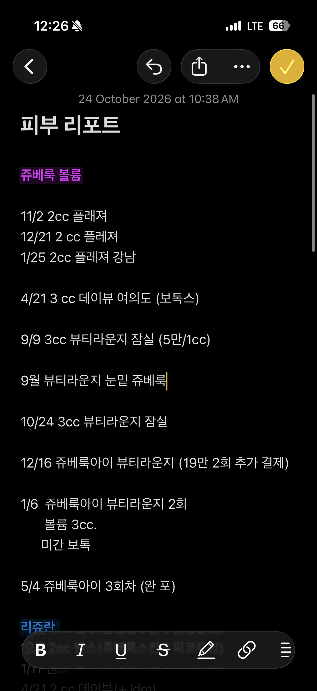
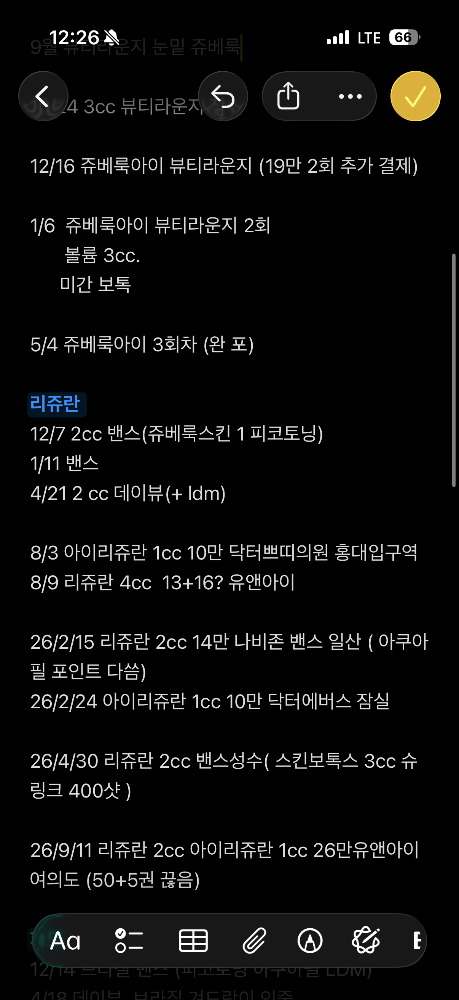
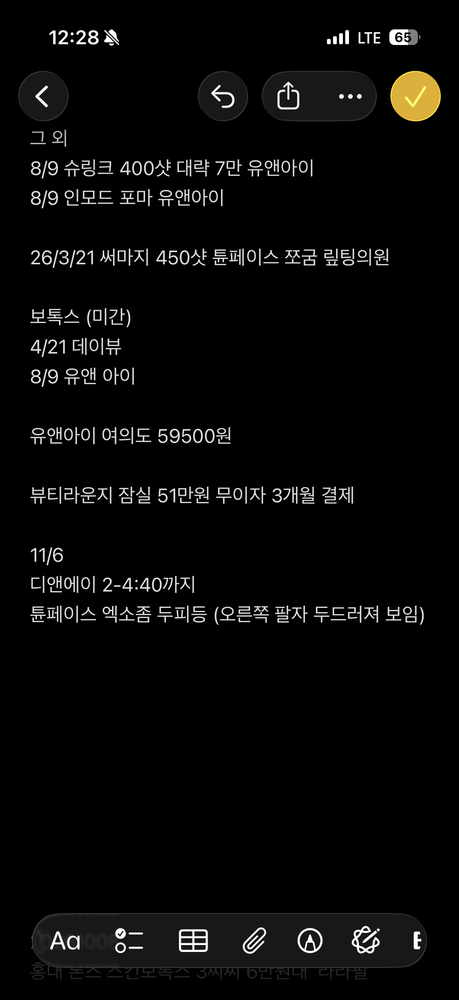

# PibooK (피북) 데모 시나리오

> 구현과 데이터의 정본은 docs/spec 이다 (오너 결정 2026-10-24). 이 문서는 발표 서사다.

> 모든 시나리오는 **채팅으로 고민을 말하는 것**에서 시작한다. 실제 화면에서는 사용자의 언어(일본어·영어·중국어)로 대화하고, 아래는 팀 공유용 한국어 스크립트다.
> `[ ]` = 그 순간 화면에 보이는 기능. 병원 이름은 데모용 가상 이름.

| # | 사용자 | 보여주는 것 | 길이 |
| --- | --- | --- | --- |
| 1 | 🇯🇵 유키 (29, 일본, 피부과 처음) | 상담 → 시술 선택 → 일정·세일 병원 → 등록 → 다음 회차 알림 → **재방한** | 메인 (2분) |
| 2 | 🇰🇷 지수 (34, 서울, 매달 피부과) | 메모장 던지기 → 알아서 알림 → 새 시술(리투오) 후기 → 최저가 예약 → 효과 체크 → 3개월 주기 | 1분 30초 |
| 3 | 🇺🇸 그레이스 (48, 뉴욕, 연 1회 방문) | 보수적·직접 상담 원함 → **연 1회 × 다운타임 없음** 시술 → 영어 상담 병원 → 상담 예약 → 1년 뒤 알림 | 1분 |
| 4 | 🇨🇳 린 (38, 상하이, 4개월마다 방한) | "주기랑 방한 일정이 안 맞아요" → 리쥬란 대신 **방한 리듬에 맞는 시술**(써마지·스킨보톡스·아쿠아필) → 연간 플랜 | 30초 |

---

## 시나리오 1. 🇯🇵 유키: "한국 언니들은 뭐 해요?"

**유키** (29세, 도쿄) · 피부과에 가본 적 없음 · 요즘 나이 들어 보여서 고민

---

**① 고민 시작**

> 🙋 **유키:** 저 일본에 사는 유키, 29살이에요. 피부과는 한 번도 안 가봤는데 요즘 늙어 보여요 ㅠㅠ 한국 언니들은 뭐 해요?

> 💬 **피북 실장:** 반가워요 유키! 피부과가 처음이면 막막하죠. 유키 또래인 **한국 30세 전후 여성들이 실제로 많이 하는 고민**은 이래요.
> 1. 팔자 주름이 파여 보임
> 2. 피부결이 거칠어짐
> 3. 턱선 탄력이 떨어짐
> 4. 눈가 잔주름
>
> 유키는 어느 부위가 제일 신경 쓰여요?

`[PibooK Recipe: 한국 30세 여성 고민 Top 4]` `[고민 영역 칩]`

---

**② 고민 부위**

> 🙋 **유키:** 팔자가 파인 게 보여요 ㅠㅠ

> 💬 **피북 실장:** 팔자가 파이면 실제 나이보다 들어 보이죠. 팔자에는 이런 선택지가 있어요.
>
> | 시술 | 이런 분께 | 효과 | 횟수·주기 | 다운타임 | 대략 가격 |
> | --- | --- | --- | --- | --- | --- |
> | **쥬베룩 볼륨** | 자연스럽게 서서히 채우고 싶은 분 | 서서히 차오름 | 매달 3회 → 이후 3~4개월마다 | 수일 붓기 | 30~60만 원 |
> | **필러** | 바로 효과를 보고 싶은 분 | 바로 | 제품별 6개월~1년 | 수일 붓기 | 1cc 5~50만 원 |
> | **스컬트라** | 오래 유지하고 싶은 분 | 서서히 | 4~6주 간격 2~3회 | 수일 붓기 | 40~80만 원 |
>
> 같은 고민의 한국 30대 여성은 **쥬베룩 볼륨**을 가장 많이 선택했어요. 팔자에 특히 잘 맞아요. 어떠세요?

`[피북 필터: 영역=볼륨, 부위=팔자 → 시술 카드 3개]` `[한국 여성 선택률]`

---

**③ 시술 선택**

> 🙋 **유키:** 쥬베룩 좋아 보여요!

> 💬 **피북 실장:** 좋은 선택이에요. 꼭 알아두실 것들이에요.
> - **횟수:** 처음엔 **한 달 간격으로 3회** 맞아야 볼륨이 제대로 차요. 그 후엔 3~4개월마다 유지해요.
> - **효과:** 바로가 아니라 몇 주에 걸쳐 서서히 차올라요.
> - **다운타임:** 며칠 붓기가 있을 수 있어요.
> - **주의:** 팔자에는 좋지만 **눈밑에는 맞지 않아요** (결절 위험). 시술 당일 주의사항은 병원 안내를 꼭 따라주세요.

`[시술 상세: 주기 타임라인 1회 → 2회 → 3회 → 유지]` `[avoid_parts 안내]`

---

**④ 일정 + 세일 병원**

> 🙋 **유키:** 저 10월 11일~13일에 한국 가요! 가능해요?

> 💬 **피북 실장:** 가능해요! 붓기가 며칠 갈 수 있으니 **도착 첫날(11일)이나 둘째 날**에 맞는 걸 추천해요. 그 기간에 쥬베룩 볼륨 **세일 중인 병원**이에요.
>
> | 병원 (가상) | 지역 | 쥬베룩 볼륨 | 이벤트 | 일본어 | 피북 사용자 |
> | --- | --- | --- | --- | --- | --- |
> | 홍대 A의원 | 홍대 | 35만 원 | 첫 방문 10% | ✅ | 1,2xx명 받음 |
> | 강남 B의원 | 강남 | 42만 원 | 3회 패키지 할인 | ✅ | 980명 |
> | 명동 C의원 | 명동 | 39만 원 | - | ✅ | 640명 |
>
> 피북에서 예약하고 시술 후 **기록하면 포인트**를 드려요!

`[피북 픽: 일정 내 이벤트 + 외국인 친화 필터]` `[병원 에이전트 견적]` `[포인트]`

---

**⑤ 시술 당일 알림 (10/13)**

> 🔔 **피북:** 유키, 쥬베룩 볼륨 하셨어요? 어디서 맞으셨어요?

> 🙋 **유키:** 네네!

> 💬 **피북 실장:** 수고했어요! 피북에 기록해두면 다음 회차를 제가 챙겨드릴게요.
>
> 🙋 **유키:** 네네 → **[기록]** 홍대 A의원 · 팔자 · 쥬베룩 볼륨 2cc · 35만 원

`[피북 기록: 3초 기록]` `[포인트 지급]` `[2회차 자동 계산: 11/13]`

---

**⑥ 한 달 뒤 (11/13)**

> 🔔 **피북:** 유키, 쥬베룩 볼륨 1회 맞으셨는데 보통 **3번 연속** 맞거든요. 2회차 하실래요?

> 🙋 **유키:** 아… 한국 가야 되나???

> 💬 **피북 실장:** 볼륨이 제대로 차려면 2·3회차가 중요해요. 유키 일정에 맞춰 볼게요.
> - **이번 달 방한 가능:** 주말 2박 3일이면 충분해요. 이달 세일 병원을 보여드릴게요.
> - **이번 달이 어려우면:** 가능한 날짜를 알려주시면 2·3회차 일정을 다시 짜드릴게요.
>
> 같은 병원에서 이어서 맞으면 3회 패키지 할인이 있는 곳도 있어요.

`[다음 회차 알림 → 계속 / 미루기 / 그만]` `[재방한 플랜]`

**👉 메시지:** 한 번 받고 끝나는 의료관광이 아니라, **주기가 다시 한국에 오게 만든다.**

---

## 시나리오 2. 🇰🇷 지수: "이제 알아서 좀 챙겨줘"

**지수** (34세, 서울 직장인) · 매달 피부과를 다님

**피북 전 지수의 한 달**
1. 시술 기록은 **아이폰 메모장**에 직접 적는다.
2. 시세는 **여신티켓**에서 대충 본다.
3. 이벤트는 **네이버 지도**에서 주변 피부과를 하나씩 눌러 **이벤트 탭**을 다 열어보고 비교한다.
4. 하나 골라서 간다. 매달 다른 피부과에 간다.
5. → **너무 귀찮다.**

---

**① 메모장 던지기 (실제 사용자 메모)**

> 아래는 기획자(보스)의 **실제 아이폰 메모장 "피부 리포트"**다.

<p>



</p>

> 텍스트로 옮긴 원문: 데모에서는 이 텍스트를 그대로 붙여넣는다. (화면에서 가려져 읽을 수 없던 몇 줄은 제외)

> 🙋 **지수:** (메모장 통째로 붙여넣기) 이거 정리해줘. 이제 알아서 좀 챙겨줘.
> ```
> 피부 리포트
>
> 쥬베룩 볼륨
> 11/2 2cc 플래져
> 12/21 2 cc 플레져
> 1/25 2cc 플레져 강남
>
> 4/21 3 cc 데이뷰 여의도 (보톡스)
>
> 9/9 3cc 뷰티라운지 잠실 (5만/1cc)
>
> 9월 뷰티라운지 눈밑 쥬베룩
>
> 10/24 3cc 뷰티라운지 잠실
>
> 12/16 쥬베룩아이 뷰티라운지 (19만 2회 추가 결제)
>
> 1/6 쥬베룩아이 뷰티라운지 2회
>     볼륨 3cc.
>     미간 보톡
>
> 5/4 쥬베룩아이 3회차 (완 포)
>
> 리쥬란
> 12/7 2cc 밴스(쥬베룩스킨 1 피코토닝)
> 1/11 밴스
> 4/21 2 cc 데이뷰(+ ldm)
>
> 8/3 아이리쥬란 1cc 10만 닥터쁘띠의원 홍대입구역
> 8/9 리쥬란 4cc 13+16? 유앤아이
>
> 26/2/15 리쥬란 2cc 14만 나비존 밴스 일산 ( 아쿠아필 포인트 다씀)
> 26/2/24 아이리쥬란 1cc 10만 닥터에버스 잠실
>
> 26/4/30 리쥬란 2cc 밴스성수( 스킨보톡스 3cc 슈링크 400샷 )
>
> 26/9/11 리쥬란 2cc 아이리쥬란 1cc 26만유앤아이 여의도 (50+5권 끊음)
>
> 그 외
> 8/9 슈링크 400샷 대략 7만 유앤아이
> 8/9 인모드 포마 유앤아이
>
> 26/3/21 써마지 450샷 툰페이스 쪼굼 릴팅의원
>
> 보톡스 (미간)
> 4/21 데이뷰
> 8/9 유앤 아이
>
> 유앤아이 여의도 59500원
>
> 뷰티라운지 잠실 51만원 무이자 3개월 결제
>
> 11/6
> 디앤에이 2-4:40까지
> 튠페이스 엑소좀 두피등 (오른쪽 팔자 두드러져 보임)
> ```

> 💬 **피북:** 정리했어요! 지난 약 2년 동안 **시술 30건 이상, 병원 10곳 이상**을 다니셨어요.
>
> **시술별 마지막 기록과 다음 시기**
> | 시술 | 마지막 | 어디서 | 다음 시기 |
> | --- | --- | --- | --- |
> | 리쥬란 2cc + 아이리쥬란 1cc | 2026/9/11 | 유앤아이 여의도 (26만) | **12월 중순~1월 중순** (3~4개월) |
> | 써마지 450샷 | 2026/3/21 | 툰페이스 | **2027년 3월** (연 1회) |
> | 스킨보톡스 3cc + 슈링크 400샷 | 2026/4/30 | 밴스 성수 | 지남 → 이번 달 확인 필요 |
> | 쥬베룩 아이 | 3회차 완료 (5/4) | 뷰티라운지 잠실 | 유지 시기 지남 → 확인 필요 |
> | 쥬베룩 볼륨 | 1/6 3cc | 뷰티라운지 잠실 | 유지 시기 지남 → 확인 필요 |
> | 미간 보톡스 | 8/9 | 유앤아이 | 지남 |
>
> **챙겨드릴 것**
> - 🎟️ **유앤아이 여의도 50+5권**이 있어요. 남은 금액을 알려주시면 다음 리쥬란 때 차감해서 계산할게요.
> - 📅 **11/6 디앤에이 14:00~16:40** 일정이 있어요. 하루 전에 알려드릴게요.
> - 👀 "오른쪽 팔자 두드러져 보임" 메모가 있어요. 다음 상담 때 같이 볼게요.
> - 💸 1cc당 가격: 쥬베룩 볼륨 **5만/1cc** (뷰티라운지), 리쥬란 2cc **14만** (나비존 밴스 일산)이 가장 저렴했어요.
>
> ❓ 연도가 없는 기록은 **2024~2025년**으로 추정했어요. 맞나요?

`[메모장 가져오기: 자유 텍스트 → 시술 기록 (Claude)]` `[다음 회차 자동 계산]` `[회차권·패키지 잔여]` `[예약 일정]` `[부위 관찰 메모]` `[1cc당 가격]` `[연도 추정 확인]`

---

**② 지수는 열심히 일하고… 피북이 먼저 연락**

> 🔔 **피북 (12월 중순):** 지수, 리쥬란 맞을 시기예요. 유앤아이 회차권으로 갈까요? 다른 것도 볼까요?

`[다음 시술 알림]` `[회차권 연동]`

---

**③ 친구들이 좋다던 그 시술**

> 🙋 **지수:** 친구들이 요즘 **리투오**가 좋다는데 진짜 안전해? 많이 맞아? 후기 좀 찾아봐.

> 💬 **피북:** 찾아봤어요.
> - **어떤 시술:** 피부결·재생 계열 주사 시술이에요. [제품 정보·허가 여부: 출시 전 확인]
> - **얼마나 받나:** 피북 사용자 중 지난 3개월 **○○○명**이 받았어요. 30대가 가장 많아요.
> - **후기 요약:** 좋았다는 후기는 "결이 매끈해짐", 아쉬웠다는 후기는 "맞을 때 아픔".
> - **효과 체감:** 보통 **3~4주 후부터**예요.
>
> 리쥬란을 2년 가까이 꾸준히 맞으셨으니, 한 번 해보고 **어느 쪽이 지수한테 맞는지 비교**해보세요. 제가 기록해서 비교해드릴게요.

`[후기 검색·요약]` `[피북 사용자 데이터]` `[내 기록 기반 추천]`

---

**④ 제일 싼 곳으로 바로 예약**

> 🙋 **지수:** 그래, 나 이번 주말에 시간 되는데 제일 싼 곳으로 갈래.

> 💬 **피북:** 이번 주말 예약 가능한 리투오 이벤트예요. **같은 용량 기준 가격**으로 정렬했어요.
>
> | 병원 (가상) | 가격 | 용량 | 주말 예약 | 피북 사용자 | 혜택 |
> | --- | --- | --- | --- | --- | --- |
> | 역삼 I의원 | ○○만 | ○cc | 토 11시 ✅ | 210명 | **첫 방문 10% 할인** |
> | 신논현 D의원 (자주 가는 곳) | ○○만 | ○cc | 일 14시 ✅ | 450명 | |
> | 강남 J의원 | ○○만 | ○cc | 토 16시 ✅ | 180명 | |
>
> 역삼 I의원은 처음이시니 **10% 할인**돼요. 고?

> 🙋 **지수:** 그럼 예약해줘.

> 💬 **피북:** 예약됐어요! **토요일 11시, 역삼 I의원.** 전날 알림 드릴게요.

`[피북 픽: 주말 + 최저가 정렬]` `[첫 방문 할인]` `[예약 에이전트]`

---

**⑤ 시술 직후**

> 🔔 **피북:** 리투오 어떠세요?

> 🙋 **지수:** 아파…..

> 💬 **피북:** 고생했어요 ㅠㅠ 아프다는 후기가 많은 시술이에요. 효과는 보통 **3~4주 후부터** 나타난대요. 그때 다시 물어볼게요.
>
> (자동 기록: 리투오 · 역삼 I의원 · 통증 "아픔")

`[시술 후 체크인]` `[자동 기록]` `[효과 체감 시점 알림 예약]`

---

**⑥ 3~4주 후**

> 🔔 **피북:** 리투오 3주 지났어요. 괜찮은 것 같아요?

> 🙋 **지수:** 네네, 다음에도 할래.

> 💬 **피북:** 좋아요! 리투오는 **3개월마다** 맞으면 돼요. 3개월 뒤에 알림 드릴게요. 리쥬란보다 리투오가 지수한테 더 맞는 걸로 기록해둘게요.

`[효과 확인 → 계속/그만]` `[다음 회차 3개월 뒤 예약]` `[시술 비교 기록]`

---

**⑦ 3개월 후**

> 🔔 **피북:** 지수, 리투오 맞을 시기예요. 이번 달 이벤트 보여드릴까요?

**👉 메시지:** 메모장 + 여신티켓 + 네이버 지도를 오가던 일을 **피북 하나가 알아서 챙긴다.** 그리고 지수의 "아파", "효과 좋음", "3개월마다"가 **유키가 보게 될 한국 여성 데이터**가 된다.

---

## 시나리오 3. 🇺🇸 그레이스: "자주 못 와요. 직접 상담받고 싶어요"

**그레이스** (48세, 뉴욕) · 보수적, 처음 보는 시술은 조심스러움 · **직접 상담**을 받고 결정하고 싶음 · 한국은 **1년에 한 번** 여행으로 옴 · 여행도 즐기고 싶음 · 영어만 가능

---

**① 상황 말하기**

> 🙋 **Grace:** I'm 48 and my jawline and skin are getting saggy. I'm pretty conservative about procedures and I want to talk to a doctor in person before deciding. I can only visit Seoul once a year, for about a week, and I want to enjoy the trip too. What would you recommend?

> 💬 **피북 실장:** 그레이스 상황을 정리하면 이래요.
> - 1년에 한 번 방문 → **1년에 1번만 받아도 되는 시술**
> - 여행을 즐겨야 함 → **다운타임이 거의 없는 시술**
> - 보수적 → **주사·실 없이 시작하는 비침습 시술 위주**
> - 직접 상담 원함 → **영어 상담 가능한 병원에서 상담 먼저**

`[상황 → 필터 조건 자동 변환: 주기=연 1회, 다운타임=당일 복귀, 방식=비침습, 언어=영어]`

---

**② 1년에 한 번, 다운타임 없는 시술**

> 💬 **피북 실장:** 같은 고민의 **한국 40대 여성**이 1년에 한 번 많이 받는 시술이에요.
>
> | 시술 | 방식 | 효과 | 유지 | 다운타임 | 통증 | 대략 가격 |
> | --- | --- | --- | --- | --- | --- | --- |
> | **울쎄라** | 초음파, 피부 속 깊은 층 리프팅 | 서서히 (1~3개월) | 약 1년 | 거의 없음 | 높음 | 300샷 100~200만 원 |
> | **써마지** | 고주파, 탄력·피부결 | 서서히 | 약 1년 | 거의 없음 | 중~높음 | 300샷 100~200만 원 |
>
> - 둘 다 **바늘·실 없이** 하는 시술이에요.
> - 시술 다음 날 바로 관광할 수 있어요.
> - 한국 40대 여성은 두 가지를 **같은 날 함께** 받기도 해요. 처음이면 하나로 시작해도 충분해요.
>
> ℹ️ 실리프팅, 필러처럼 붓기·멍이 며칠 갈 수 있는 시술은 이번 여행 일정에서는 뺐어요.

`[피북 필터: 리프팅 × 연 1회 × 다운타임 없음 × 비침습 → 2개]` `[PibooK Recipe: 한국 40대 여성]` `[제외 사유 안내]`

---

**③ 영어로 직접 상담할 수 있는 병원**

> 🙋 **Grace:** I'd like to consult with a doctor first. Can you find clinics where I can talk in English?

> 💬 **피북 실장:** 영어 상담이 되는 곳만 골랐어요.
>
> | 병원 (가상) | 영어 상담 | 영어권 환자 | 영어 후기 | 상담 | 울쎄라/써마지 |
> | --- | --- | --- | --- | --- | --- |
> | 강남 K의원 | **원장 직접 영어** | 많음 | 140건 ⭐4.7 | 무료 상담 | 둘 다 |
> | 압구정 L의원 | **영어 코디네이터 동행** | 많음 | 95건 ⭐4.6 | 무료 상담 | 둘 다 |
> | 명동 M의원 | 통역 앱·전화 통역 | 보통 | 40건 ⭐4.4 | 유료 상담 | 써마지 |
>
> 상담만 먼저 예약하고, 상담 후 결정하셔도 돼요. 받기로 하면 **같은 날 바로 시술**도 가능한 곳이에요.

`[언어 지원 필터: 원장 영어 / 코디네이터 / 통역]` `[영어권 고객 비율·영어 후기]` `[상담 우선 예약]`

---

**④ 상담 예약 + 일정**

> 🙋 **Grace:** Book a consultation at the first one. I'm in Seoul Oct 20–27.

> 💬 **피북 실장:** **10월 21일(도착 다음 날) 오후 2시, 강남 K의원 영어 상담**으로 예약했어요.
> - 상담 때 물어볼 질문 리스트를 영어로 준비해 드릴게요. (통증, 효과 시점, 주의사항, 가격 포함 범위)
> - 시술을 받기로 하면 남은 일정 동안 편하게 여행하셔도 돼요.

`[상담 예약 에이전트]` `[상담 질문 리스트 생성]`

---

**⑤ 시술 후 + 1년 뒤**

> 🔔 **피북 (시술 다음 날):** How are you feeling? 효과는 1~3개월에 걸쳐 서서히 나타나요. 뉴욕에서 2개월 뒤에 한 번 물어볼게요.

> 🔔 **피북 (다음 해 8월):** 그레이스, 써마지 1년이 다가와요. 올해 서울 여행은 언제예요? 일정에 맞춰 같은 병원 상담을 잡아드릴게요.

`[시술 후 체크인]` `[1년 주기 알림 → 다음 여행 계획]`

**👉 메시지:** 보수적이고 자주 못 오는 고객에게는 **1년 주기 × 다운타임 없음 × 영어 직접 상담**으로 맞춘다. 1년 주기 알림이 **다음 서울 여행**을 만든다.

---

## 시나리오 4. 🇨🇳 린: "주기랑 방한 일정이 안 맞아요"

**린** (38세, 상하이) · 피부결·탄력 고민 · 한국은 **3월, 7월, 11월** (약 4개월 간격) 출장 겸 방문 · 친구 추천으로 리쥬란에 관심

---

**① 원래 하고 싶던 시술**

> 🙋 **린:** 피부결이 거칠고 탄력이 떨어져요. 친구가 리쥬란 좋다던데 해보고 싶어요. 한국은 3월, 7월, 11월에 가요.

> 💬 **피북 실장:** 리쥬란은 한국 30대 후반 여성이 피부결 고민에 많이 받는 시술이에요. 그런데 리쥬란은 처음에 **한 달 간격으로 3회**를 맞아야 해요. 린은 4개월에 한 번 오셔서 **초기 3회를 채우기 어려워요.**

`[주기 × 방한 일정 대조 → 불일치 감지]`

---

**② 주기가 안 맞으니, 일정에 맞는 시술로 바꿔 추천**

> 🙋 **린:** 주기랑 방한 일정이 안 맞네요…

> 💬 **피북 실장:** 그럼 리쥬란 대신 **린의 4개월 방한 리듬에 맞는 시술**로 추천해 드릴게요.
>
> | 시술 | 고민 | 왜 린에게 맞나 | 주기 | 다운타임 | 대략 가격 |
> | --- | --- | --- | --- | --- | --- |
> | **써마지** | 탄력·피부결 | **1년에 1번**이면 돼서 방한 한 번에 해결 | 연 1회 | 거의 없음 | 300샷 100~200만 원 |
> | **스킨보톡스** | 피부결·모공 | 효과가 2~3개월 가서 **매 방한 때 한 번씩** 받기 좋음 | 2~3개월 | 1일 | 10~30만 원 |
> | **아쿠아필** | 결·광채 | 받은 날 바로 효과, **출장 중 부담 없음** | 방문 때마다 | 없음 | 2~6만 원 |
>
> 이렇게 이거 대신 해보세요.
> - **11월:** 써마지 (1년 탄력 관리) + 아쿠아필
> - **3월:** 스킨보톡스 + 아쿠아필
> - **7월:** 스킨보톡스 + 아쿠아필
>
> 나중에 한국에 한 달 이상 머무는 일정이 생기면, 그때 리쥬란 초기 3회를 잡아드릴게요.

`[대체 시술 추천: 같은 고민 영역 × 방한 간격에 맞는 주기]` `[연간 방한 플랜]`

---

**③ 연간 플랜 저장 → 방한 전 알림**

> 🙋 **린:** 좋아요, 그렇게 할게요.

> 💬 **피북:** 연간 플랜을 저장했어요. 매번 **방한 2주 전**에 그 시기 이벤트 병원과 중국어 상담 가능한 곳을 보내드릴게요.

> 🔔 **피북 (2월 중순):** 린, 3월 방한이 다가와요. 스킨보톡스 + 아쿠아필 이벤트 병원이에요. 중국어 상담 가능한 곳만 골랐어요.

`[방한 일정 기반 알림]` `[언어 지원 필터: 중국어]`

**👉 메시지:** 주기가 안 맞으면 포기시키는 게 아니라, **고객의 방한 리듬에 맞는 시술로 바꿔준다.**

---

## 발표 흐름 제안 (3분)

1. **문제 (20초):** 피부과 시술은 종류·주기·용량·다운타임이 복잡하다. 외국인은 두렵고, 한국 여성은 메모장에 기록한다.
2. **시나리오 1 유키 (1분):** 상담 → 쥬베룩 볼륨 → 세일 병원 → 기록 → "한국 가야 되나?"
3. **시나리오 2 지수 (45초):** 메모장 던지기 → "알아서 챙겨줘" → 리투오 예약 → "아파…" → 3주 뒤 효과 체크. 지수의 기록이 유키가 본 데이터가 된다.
4. **시나리오 3 그레이스 (25초):** "자주 못 오고 직접 상담 원해요" → 연 1회·다운타임 없는 시술 + 영어 상담 병원.
5. **시나리오 4 린 (20초):** 주기가 안 맞으면 포기 대신 대체 시술로 연간 플랜.
6. **마무리 (20초):** 기록 → 데이터 → 신뢰 → 재방한 → 병원 수익.
