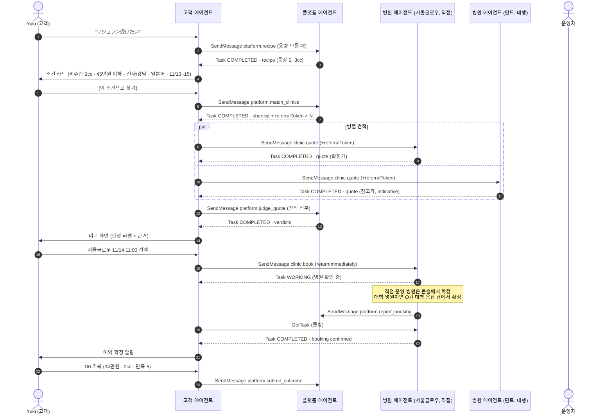

# 03 · A2A 프로토콜 설계

기준: A2A Protocol v1.0 (정본 리포 https://github.com/a2aproject/A2A , 최신 릴리스 v1.0.1 · 2026-05-28, 스펙 문서 https://a2a-protocol.org/latest/specification/ ). 구현 SDK: `@a2a-js/sdk` 1.3.0 (`A2A_PROTOCOL_VERSION = "1.0"` 확인, 2026-10-24).

> Sonnet에게: 필드 이름이 헷갈리면 이 문서보다 `node_modules/@a2a-js/sdk/dist/*.d.ts`와 정본 `specification/a2a.proto`가 우선이다. 이 문서의 JSON은 proto 필드의 JSON 이름(lowerCamelCase)을 따른다.

## 바인딩과 엔드포인트

- 프로토콜 바인딩은 **JSON-RPC 2.0 over HTTP** (`protocolBinding: "JSONRPC"`) 하나만 구현한다. (HTTP+JSON, gRPC는 범위 밖)
- 메서드 이름은 v1.0 PascalCase: `SendMessage`, `SendStreamingMessage`, `GetTask`, `ListTasks`, `CancelTask`, `SubscribeToTask`, `GetExtendedAgentCard`. P0는 `SendMessage`, `GetTask`, `CancelTask`만 쓴다.
- 요청 헤더: `Content-Type: application/json`, `A2A-Version: 1.0`, `Authorization: Bearer <agent token>`, 확장 사용 시 `A2A-Extensions: <uri,...>`.

| 에이전트 | Agent Card URL | JSON-RPC URL | 공개 여부 |
| --- | --- | --- | --- |
| 플랫폼 | `/a2a/platform/agent-card.json` (루트 `/.well-known/agent-card.json`도 같은 카드로 rewrite) | `/a2a/platform/rpc` | 공개 |
| 병원 | `/a2a/clinics/{slug}/agent-card.json` | `/a2a/clinics/{slug}/rpc` | 공개 |
| 고객 | `/a2a/customers/{agentId}/agent-card.json` | `/a2a/customers/{agentId}/rpc` | 인증 필요 (bearer 없으면 401) |
| 플랫폼 공개키 | `/a2a/platform/jwks.json` | | 공개 |

`{agentId}`는 가명 id(`cag_` 접두사)이며 고객 실명·이메일과 무관하다.

## 스킬 라우팅 규칙

A2A Message에는 스킬 id 필드가 없다. 이 서비스는 다음 규칙으로 스킬을 지정한다.

1. 요청 Message의 `metadata.skillId`에 스킬 id를 넣는다. (필수)
2. 첫 번째 DataPart의 `data.schema`에 입력 스키마 이름을 넣는다. 서버는 `skillId`와 `schema` 조합이 아래 표와 다르면 JSON-RPC 에러 `-32602`(invalid params)로 거절한다.
3. **예외 (추가 정보 응답):** 요청에 `taskId`가 있고 그 태스크가 `TASK_STATE_INPUT_REQUIRED`면, `skillId`는 원래 스킬 그대로 두고 DataPart `schema`는 `pibu/input-response@1`이어야 한다. 이 조합은 아래 표에 없어도 허용한다. 태스크가 `INPUT_REQUIRED`가 아닌데 `pibu/input-response@1`이 오면 `-32602`.
4. 같은 메시지에 사람이 읽을 `text` Part를 함께 넣을 수 있다 (로그·진행 화면 표시용). 서버 로직은 DataPart만 신뢰한다.

| 스킬 id | 입력 `data.schema` | 출력 (Task artifact 또는 Message의 DataPart) |
| --- | --- | --- |
| `platform.recipe` | `pibu/recipe-query@1` | `pibu/recipe@1` |
| `platform.match_clinics` | `pibu/procedure-request@1` | `pibu/clinic-shortlist@1` |
| `platform.judge_quote` | `pibu/judge-request@1` | `pibu/fairness-verdict-list@1` |
| `platform.report_booking` | `pibu/booking@1` | text 확인 |
| `platform.submit_outcome` | `pibu/outcome@1` | text 확인 |
| `platform.report_signal` | `pibu/signal-report@1` | text 확인 |
| `clinic.offers` | `pibu/offers-query@1` | `pibu/offers@1` |
| `clinic.quote` | `pibu/procedure-request@1` | `pibu/quote@1` |
| `clinic.availability` | `pibu/availability-query@1` | `pibu/availability@1` |
| `clinic.book` | `pibu/booking-request@1` | `pibu/booking@1` |
| `clinic.cancel` | `pibu/cancel-request@1` | `pibu/booking@1` |
| `customer.notify` | `pibu/notification@1` | text 확인 |
| `customer.checkin` | `pibu/checkin-request@1` | `pibu/outcome@1` |

## 응답 형태 규칙

- 즉시 끝나는 스킬(`platform.recipe`, `platform.match_clinics`, `platform.judge_quote`, `clinic.offers`, `clinic.quote`, `clinic.availability`, `*.notify`, `platform.report_booking`, `platform.submit_outcome`)은 **Task를 `TASK_STATE_COMPLETED`로 반환**하고 결과를 `artifacts[0].parts[0].data`에 담는다. (Message 단독 응답은 쓰지 않는다. 로그·재조회를 Task 하나로 통일하기 위해서)
- 사람 확인이 필요한 스킬(`clinic.book`, `customer.checkin`)은 호출자가 반드시 `configuration.returnImmediately: true`로 보낸다. A2A 1.0 기본값(`false`)이면 서버는 태스크가 terminal 또는 interrupted(`INPUT_REQUIRED`, `AUTH_REQUIRED`) 상태가 될 때까지 응답을 보류해야 하고(`a2a.proto` `SendMessageConfiguration.return_immediately`), `WORKING`은 interrupted가 아니라서 운영자 확정까지 최대 10분 동안 HTTP가 묶인다. `returnImmediately: true`면 서버는 `TASK_STATE_WORKING` 태스크를 바로 돌려주고, 호출자는 `GetTask`로 폴링한다 (P0: 3초 간격, 최대 10분). 즉시 끝나는 스킬은 기본값(`false`)으로 보낸다. 푸시 알림(`pushNotifications`)은 P1.
- JSON-RPC 응답 모양: `SendMessage`의 `result`는 `{ "task": { ... } }` 래퍼다 (`SendMessageResponse`, 이 서비스는 `message` 변형을 쓰지 않는다). `GetTask`의 `result`는 래퍼 없이 Task 자체다. 클라이언트는 `result.task`를 꺼낸다. 아래 "SendMessage 응답 와이어 예시" 참고.
- 결과 artifact에는 `artifactId`(필수)를 넣는다. 데이터 결과는 `parts[0].data`, 텍스트 확인만 주는 스킬(`platform.report_booking`, `platform.submit_outcome`, `platform.report_signal`, `customer.notify`)은 `parts[0].text`.

## 태스크 상태 매핑

| A2A 상태 | 이 서비스에서의 의미 | 고객 화면 문구 (ko) |
| --- | --- | --- |
| `TASK_STATE_SUBMITTED` | 접수됨 | 요청을 보냈어요 |
| `TASK_STATE_WORKING` | 처리 중. 대행 병원 예약이면 운영자가 병원에 확인 중 | 병원에서 확인하고 있어요 |
| `TASK_STATE_INPUT_REQUIRED` | 상대 에이전트가 추가 정보를 요구. `status.message`의 DataPart `pibu/input-request@1`에 필요한 필드 목록 | 병원이 정보를 더 요청했어요 |
| `TASK_STATE_COMPLETED` | 완료. 결과는 artifact | 완료됐어요 |
| `TASK_STATE_REJECTED` | 상대가 거절 (추천 토큰 무효, 해당 시술 없음, 정원 초과, 유치 대상 아님) | 이 병원은 요청을 받을 수 없어요 |
| `TASK_STATE_FAILED` | 처리 오류 | 문제가 생겼어요. 다시 시도할게요 |
| `TASK_STATE_CANCELED` | 취소됨 | 취소됐어요 |
| `TASK_STATE_AUTH_REQUIRED` | 인증 필요 (토큰 만료) | (내부 재발급 후 재시도, 고객에게 노출 안 함) |

## 확장 (Extensions)

| URI | 선언 위치 | required | 내용 |
| --- | --- | --- | --- |
| `https://pibu.app/ext/clinic-operation/v1` | 병원 카드 | false | 운영 모드와 데이터 출처. `params`: `mode`(`proxy` 또는 `clinic`), `dataSources`(`sms`, `public_web`, `clinic_input`), `lastVerifiedAt`, `foreignPatientFacilityRegistered`(bool) |
| `https://pibu.app/ext/referral/v1` | 병원 카드 | false | `clinic.quote`, `clinic.book` 요청은 `metadata.referralToken`에 플랫폼 추천 토큰이 있어야 한다. 없거나 무효면 `TASK_STATE_REJECTED`. `required: false`인 이유: A2A 1.0은 `required: true` 확장을 클라이언트가 선언하지 않으면 모든 요청에 `ExtensionSupportRequiredError`(-32008)를 내야 하는데, `clinic.offers`·`availability`·`cancel`은 토큰 없이 호출한다. 토큰 강제는 스킬 단위로 병원 에이전트가 한다 |
| `https://pibu.app/ext/consent/v1` | 고객 카드 | false | 고객 에이전트가 보내는 개인 필드에는 `metadata.consentRef`(동의 원장 항목 id)가 붙는다 |

## Agent Card 예시

아래 3개 JSON은 A2A 1.0 필수 필드를 모두 갖는다 (검증: `node scripts/verify-spec.mjs agentcards`). 실제 서버는 `PUBLIC_BASE_URL` 환경 변수로 URL을 만든다. 예시는 `https://pibu.example`.

### 플랫폼 에이전트 카드

```json
{
  "name": "Pibu Platform Agent",
  "description": "Matches K-beauty clinic requests with clinics using real paid-price records, judges whether a quoted price and dose are fair, and collects post-procedure outcomes.",
  "supportedInterfaces": [
    { "url": "https://pibu.example/a2a/platform/rpc", "protocolBinding": "JSONRPC", "protocolVersion": "1.0" }
  ],
  "provider": { "organization": "Pibu", "url": "https://pibu.example" },
  "version": "0.1.0",
  "documentationUrl": "https://github.com/goranyseoul/jongro3ga/blob/main/docs/spec/03-a2a-protocol.md",
  "capabilities": { "streaming": false, "pushNotifications": false, "extendedAgentCard": false },
  "securitySchemes": {
    "pibuBearer": { "httpAuthSecurityScheme": { "scheme": "bearer", "bearerFormat": "JWT", "description": "Agent token issued by Pibu" } }
  },
  "securityRequirements": [ { "schemes": { "pibuBearer": { "list": [] } } } ],
  "defaultInputModes": ["application/json", "text/plain"],
  "defaultOutputModes": ["application/json", "text/plain"],
  "skills": [
    {
      "id": "platform.recipe",
      "name": "Korean women procedure recipe",
      "description": "Returns which procedures Korean women with the same concern and age band actually chose, typical dose, cycle, downtime and onset, from recorded data.",
      "tags": ["recipe", "procedure", "data"],
      "examples": ["{\"schema\":\"pibu/recipe-query@1\",\"concerns\":[\"elasticity\"],\"ageBand\":\"25-29\"}"],
      "inputModes": ["application/json"],
      "outputModes": ["application/json"]
    },
    {
      "id": "platform.match_clinics",
      "name": "Match clinics",
      "description": "Ranks up to five clinics for a procedure request and issues a signed referral token per clinic.",
      "tags": ["matching", "clinic", "referral"],
      "inputModes": ["application/json"],
      "outputModes": ["application/json"]
    },
    {
      "id": "platform.judge_quote",
      "name": "Judge quote fairness",
      "description": "Judges each quote's unit price and dose against recent verified paid records in the same region.",
      "tags": ["price", "fairness", "dose"],
      "inputModes": ["application/json"],
      "outputModes": ["application/json"]
    },
    {
      "id": "platform.report_booking",
      "name": "Report booking",
      "description": "Clinic agents report confirmed bookings with the referral token for attribution.",
      "tags": ["booking", "attribution"],
      "inputModes": ["application/json"],
      "outputModes": ["text/plain"]
    },
    {
      "id": "platform.report_signal",
      "name": "Report signal",
      "description": "Customer agents report clinic response timeouts and rejections observed while requesting quotes.",
      "tags": ["signal", "reliability"],
      "inputModes": ["application/json"],
      "outputModes": ["text/plain"]
    },
    {
      "id": "platform.submit_outcome",
      "name": "Submit outcome",
      "description": "Customer agents submit paid price, received dose and satisfaction after a procedure.",
      "tags": ["review", "outcome"],
      "inputModes": ["application/json"],
      "outputModes": ["text/plain"]
    }
  ]
}
```

### 병원 에이전트 카드 (대행 운영 예시: 민트피부과의원)

```json
{
  "name": "Mint Dermatology Clinic Agent",
  "description": "Answers prices, doses, monthly offers and available times for Mint Dermatology Clinic (Gangnam), and accepts booking requests referred by Pibu.",
  "supportedInterfaces": [
    { "url": "https://pibu.example/a2a/clinics/mint/rpc", "protocolBinding": "JSONRPC", "protocolVersion": "1.0" }
  ],
  "provider": { "organization": "Pibu (operating on behalf of Mint Dermatology Clinic)", "url": "https://pibu.example" },
  "version": "0.1.0",
  "capabilities": {
    "streaming": false,
    "pushNotifications": false,
    "extensions": [
      {
        "uri": "https://pibu.app/ext/clinic-operation/v1",
        "description": "Operation mode and data provenance of this clinic agent",
        "required": false,
        "params": { "mode": "proxy", "dataSources": ["sms", "public_web"], "lastVerifiedAt": "2026-10-20", "foreignPatientFacilityRegistered": true }
      },
      {
        "uri": "https://pibu.app/ext/referral/v1",
        "description": "quote and book requests must carry a Pibu referral token in metadata.referralToken",
        "required": false
      }
    ]
  },
  "securitySchemes": {
    "pibuBearer": { "httpAuthSecurityScheme": { "scheme": "bearer", "bearerFormat": "JWT" } }
  },
  "securityRequirements": [ { "schemes": { "pibuBearer": { "list": [] } } } ],
  "defaultInputModes": ["application/json", "text/plain"],
  "defaultOutputModes": ["application/json", "text/plain"],
  "skills": [
    { "id": "clinic.offers", "name": "Monthly offers", "description": "Lists this month's offers and regular menu prices.", "tags": ["price", "event"] },
    { "id": "clinic.quote", "name": "Quote", "description": "Quotes total price, unit price, dose, product, inclusions and slots for a procedure request.", "tags": ["price", "quote"] },
    { "id": "clinic.availability", "name": "Availability", "description": "Returns open slots for a procedure in a date range.", "tags": ["schedule"] },
    { "id": "clinic.book", "name": "Book", "description": "Requests a booking. Proxy-operated clinics confirm after a human check, so the task stays working until confirmed.", "tags": ["booking"] },
    { "id": "clinic.cancel", "name": "Cancel booking", "description": "Cancels a booking made through Pibu.", "tags": ["booking"] }
  ]
}
```

### 고객 에이전트 카드 (Yuki)

```json
{
  "name": "Pibu Customer Agent cag_7f3k2",
  "description": "Personal agent acting on behalf of one Pibu customer. Receives booking updates and outcome check-ins.",
  "supportedInterfaces": [
    { "url": "https://pibu.example/a2a/customers/cag_7f3k2/rpc", "protocolBinding": "JSONRPC", "protocolVersion": "1.0" }
  ],
  "provider": { "organization": "Pibu (hosting on behalf of the customer)", "url": "https://pibu.example" },
  "version": "0.1.0",
  "capabilities": {
    "streaming": false,
    "pushNotifications": false,
    "extensions": [
      { "uri": "https://pibu.app/ext/consent/v1", "description": "Personal fields carry metadata.consentRef", "required": false }
    ]
  },
  "securitySchemes": {
    "pibuBearer": { "httpAuthSecurityScheme": { "scheme": "bearer", "bearerFormat": "JWT" } }
  },
  "securityRequirements": [ { "schemes": { "pibuBearer": { "list": [] } } } ],
  "defaultInputModes": ["application/json", "text/plain"],
  "defaultOutputModes": ["application/json", "text/plain"],
  "skills": [
    { "id": "customer.notify", "name": "Receive notification", "description": "Receives booking confirmations, changes, reminders and notices from clinics and the platform.", "tags": ["notification"] },
    { "id": "customer.checkin", "name": "Outcome check-in", "description": "Answers platform follow-up questions about a past procedure, asking the customer when needed.", "tags": ["outcome", "review"] }
  ]
}
```

## 메시지 스키마 (`pibu/*@1`)

TypeScript 정의와 zod 스키마의 정본은 `lib/a2a/schemas.ts` ([06-data-model.md](06-data-model.md) 참고). 여기서는 와이어 예시를 정한다. 금액은 모두 **원(KRW) 정수**, 날짜는 `YYYY-MM-DD`, 시각은 ISO 8601(`+09:00`).

### `pibu/procedure-request@1` (고객 → 플랫폼, 고객 → 병원)

```json
{
  "schema": "pibu/procedure-request@1",
  "requestId": "req_01J9Z8",
  "customerAgentId": "cag_7f3k2",
  "procedureId": "rejuran_healer",
  "productPreference": "any",
  "amount": { "value": 2, "unit": "cc" },
  "budgetKrw": { "max": 450000 },
  "areas": ["sinsa", "gangnam", "apgujeong"],
  "languages": ["ja"],
  "dateWindow": { "from": "2026-11-13", "to": "2026-11-15" },
  "visitorProfile": { "nationality": "JP", "residency": "short_term_visitor", "ageBand": "25-29", "firstKProcedure": true },
  "notes": "Prefer short downtime, flying home on 11-15 evening"
}
```

필드 규칙:

| 필드 | 필수 여부 | 비고 |
| --- | --- | --- |
| `schema`, `requestId`, `customerAgentId`, `procedureId`, `amount`, `languages`, `dateWindow` | 항상 필수 | |
| `visitorProfile.nationality` | 항상 필수 | |
| `visitorProfile.residency`, `visitorProfile.ageBand` | `platform.match_clinics`에서 필수, 병원으로 보낼 때는 **제거** | |
| `productPreference`, `budgetKrw`, `areas`, `visitorProfile.firstKProcedure`, `notes` | 선택 | 병원으로 보낼 때 `notes`, `budgetKrw` 제거 |

병원으로 가는 사본에 남는 필드는 정확히: `schema`, `requestId`, `customerAgentId`, `procedureId`, `productPreference`, `amount`, `areas`, `languages`, `dateWindow`, `visitorProfile.nationality`, `visitorProfile.firstKProcedure`. zod에는 공통 스키마 하나에 `.superRefine`으로 수신자별 규칙을 둔다 (`parsePibuData`가 `skillId`로 분기).

`visitorProfile.residency`는 `short_term_visitor` 또는 `resident`. 플랫폼은 `nationality = "KR"`이거나 `residency = "resident"`면 매칭하지 않고 `TASK_STATE_REJECTED`(사유 `not_eligible_foreign_patient`)로 답한다 ([08-compliance.md](08-compliance.md) 2절).

고객 에이전트가 동의 원장 기준으로 위 표대로 필터한다.

### `pibu/clinic-shortlist@1` (플랫폼 → 고객)

```json
{
  "schema": "pibu/clinic-shortlist@1",
  "requestId": "req_01J9Z8",
  "matchId": "mt_4401",
  "appliedRuleIds": [],
  "priceReference": { "procedureId": "rejuran_healer", "unit": "cc", "region": "gangnam_sinsa", "p25UnitKrw": 140000, "p50UnitKrw": 160000, "p75UnitKrw": 185000, "sampleSize": 42, "windowDays": 120 },
  "candidates": [
    {
      "clinicId": "cln_seoul_glow",
      "agentCardUrl": "https://pibu.example/a2a/clinics/seoul-glow/agent-card.json",
      "score": 0.86,
      "reasons": ["Japanese-speaking coordinator on site", "Paid prices close to quotes in 18 past outcomes", "Open slots on 11-14"],
      "referralToken": "eyJhbGciOiJFUzI1NiJ9.example.signature"
    }
  ]
}
```

### `pibu/quote@1` (병원 → 고객)

```json
{
  "schema": "pibu/quote@1",
  "quoteId": "qt_88a1",
  "requestId": "req_01J9Z8",
  "clinicId": "cln_mint",
  "procedureId": "rejuran_healer",
  "product": "Rejuran Healer",
  "amount": { "value": 1, "unit": "cc" },
  "priceKrw": 99000,
  "vatIncluded": true,
  "includes": ["numbing_cream"],
  "excludes": ["soothing_mask"],
  "event": { "title": "First visit 1cc event", "regularPriceKrw": 150000, "validFrom": "2026-11-01", "validUntil": "2026-11-30", "conditions": "First visit only" },
  "slots": ["2026-11-13T15:00:00+09:00", "2026-11-14T11:00:00+09:00"],
  "languages": ["ja", "en"],
  "indicative": true,
  "validUntil": "2026-11-10",
  "operationMode": "proxy"
}
```

### `pibu/judge-request@1` · `pibu/fairness-verdict-list@1` (고객과 플랫폼 양방향)

```json
{
  "schema": "pibu/judge-request@1",
  "requestId": "req_01J9Z8",
  "matchId": "mt_4401",
  "quotes": [ { "quoteId": "qt_88a1", "clinicId": "cln_mint", "procedureId": "rejuran_healer", "amount": { "value": 1, "unit": "cc" }, "priceKrw": 99000, "vatIncluded": true, "includes": ["numbing_cream"] } ]
}
```

```json
{
  "schema": "pibu/fairness-verdict-list@1",
  "requestId": "req_01J9Z8",
  "verdicts": [
    {
      "quoteId": "qt_88a1",
      "normalizedUnitKrw": 99000,
      "priceBand": "low",
      "doseFlag": "below_typical",
      "typicalAmount": { "min": 2, "max": 3, "unit": "cc" },
      "clinicFlags": [ { "code": "indicative_price" } ],
      "label": "underdosed",
      "confidence": "high",
      "sampleSize": 42,
      "explanation": { "en": "1cc is below the 2~3cc Korean women in their late 20s usually receive. The unit price is low, but the total treatment is smaller.", "ja": "1ccは、韓国の20代後半女性が通常受ける2~3ccより少ない量です。単価は安いですが、施術量も少なくなります。", "ko": "1cc는 한국 20대 후반 여성이 보통 받는 2~3cc보다 적어요. 단가는 낮지만 시술량도 적어요." }
    }
  ]
}
```

판정 규칙은 [07-platform-intelligence.md](07-platform-intelligence.md).

### `pibu/booking-request@1` · `pibu/booking@1` (고객과 병원 양방향, 병원 → 플랫폼)

```json
{
  "schema": "pibu/booking-request@1",
  "requestId": "req_01J9Z8",
  "quoteId": "qt_1203",
  "clinicId": "cln_seoul_glow",
  "slot": "2026-11-14T11:00:00+09:00",
  "guest": { "displayName": "Yuki T.", "contactChannel": "line", "contactHandle": "yuki_demo", "language": "ja" },
  "safetyInfo": { "pregnantOrBreastfeeding": false, "allergies": [], "anticoagulants": false, "recentIsotretinoin": false, "keloidHistory": false },
  "consentRef": "cns_0091"
}
```

```json
{
  "schema": "pibu/booking@1",
  "bookingId": "bkg_5521",
  "requestId": "req_01J9Z8",
  "quoteId": "qt_1203",
  "clinicId": "cln_seoul_glow",
  "customerAgentId": "cag_7f3k2",
  "slot": "2026-11-14T11:00:00+09:00",
  "status": "confirmed",
  "confirmedBy": "clinic_staff",
  "priceKrw": 340000,
  "referralToken": "eyJhbGciOiJFUzI1NiJ9.example.signature",
  "instructions": { "ja": "当日はノーメイクでお越しください。", "en": "Please come without makeup." }
}
```

`status`: `pending_clinic` · `confirmed` · `canceled` · `no_show` · `completed`.

### `pibu/input-request@1` (병원 → 고객, `TASK_STATE_INPUT_REQUIRED`의 status.message 안)

```json
{
  "schema": "pibu/input-request@1",
  "fields": [
    { "key": "passportName", "label": { "en": "Name as on passport", "ja": "パスポート記載の氏名" }, "sensitive": true },
    { "key": "lastRejuranDate", "label": { "en": "Date of your last Rejuran", "ja": "前回のリジュラン施術日" }, "sensitive": false }
  ]
}
```

호출자는 같은 `taskId`로 `SendMessage`를 다시 보내 `pibu/input-response@1`(`{ "schema": "pibu/input-response@1", "values": { "passportName": "..." } }`)로 답한다.

### `pibu/outcome@1` (고객 → 플랫폼)

```json
{
  "schema": "pibu/outcome@1",
  "outcomeId": "out_3310",
  "bookingId": "bkg_5521",
  "clinicId": "cln_seoul_glow",
  "procedureId": "rejuran_healer",
  "checkpoint": "D0",
  "paidKrw": 340000,
  "receivedAmount": { "value": 2, "unit": "cc" },
  "productVerified": "vial_shown",
  "receiptAttached": true,
  "satisfaction": 5,
  "painScore": 3,
  "downtimeDaysActual": null,
  "wouldReturn": true,
  "sideEffects": [],
  "comment": "Explained everything in Japanese.",
  "visitorProfile": { "nationality": "JP", "ageBand": "25-29" },
  "submittedAt": "2026-11-14T13:10:00+09:00"
}
```

### 나머지 스키마

| 스키마 | 필수 필드 |
| --- | --- |
| `pibu/recipe-query@1` | `concerns[]`, `ageBand`, 선택 `procedureIds[]` |
| `pibu/recipe@1` | `combinations[{ procedureIds[], share, sampleSize }]`, `procedures[{ procedureId, typicalAmount, cycle, downtimeDays, onsetDays }]`, `disclaimer` |
| `pibu/offers-query@1` | 선택 `month` |
| `pibu/offers@1` | `clinicId`, `month`, `items[{ procedureId, product, amount, priceKrw, vatIncluded, event? }]`. `event`가 있으면 `title`, `regularPriceKrw`, `validFrom`, `validUntil`, `conditions` 모두 필수 (의료법 시행령 제23조제1항제13호, [08-compliance.md](08-compliance.md)) |
| `pibu/availability-query@1` | `procedureId`, `from`, `to` |
| `pibu/availability@1` | `clinicId`, `slots[]`, `indicative` |
| `pibu/cancel-request@1` | `bookingId`, `reason` |
| `pibu/notification@1` | `kind`(`booking_confirmed` · `booking_changed` · `reminder` · `notice`), `bookingId?`, `text{ locale: string }` |
| `pibu/checkin-request@1` | `bookingId`, `checkpoint`(`D7` · `D30`), `questions[]` |
| `pibu/fairness-verdict@1` | 위 `verdicts[]`의 원소: `quoteId`, `normalizedUnitKrw`, `priceBand`(`low` · `mid` · `high` · `very_high` · `insufficient`), `doseFlag`(`below_typical` · `within` · `above_typical`), `typicalAmount`, `clinicFlags[{ code: "paid_more_than_quoted" \| "indicative_price", avgGapPct? }]`, `label`, `confidence`(`high` · `medium` · `low` · `none`), `sampleSize`, `explanation` |
| `pibu/input-request@1` · `pibu/input-response@1` | 위 예시. 라우팅 예외 (스킬 라우팅 규칙 3번) |
| `pibu/signal-report@1` | `clinicId`, `kind`(`response_timeout` · `rejection`), `taskId?`, `requestId`, `at` |

## 전체 시퀀스: "리주란 받고 싶어"



## SendMessage 와이어 예시 (고객 → 병원 견적)

```json
{
  "jsonrpc": "2.0",
  "id": "rpc_0003",
  "method": "SendMessage",
  "params": {
    "message": {
      "messageId": "msg_c_0003",
      "contextId": "req_01J9Z8",
      "role": "ROLE_USER",
      "parts": [
        { "text": "Quote request for Rejuran Healer 2cc, 11-13~11-15, Japanese support." },
        { "data": { "schema": "pibu/procedure-request@1", "requestId": "req_01J9Z8", "customerAgentId": "cag_7f3k2", "procedureId": "rejuran_healer", "amount": { "value": 2, "unit": "cc" }, "languages": ["ja"], "dateWindow": { "from": "2026-11-13", "to": "2026-11-15" }, "visitorProfile": { "nationality": "JP", "firstKProcedure": true } }, "mediaType": "application/json" }
      ],
      "metadata": { "skillId": "clinic.quote", "referralToken": "eyJhbGciOiJFUzI1NiJ9.example.signature" },
      "extensions": ["https://pibu.app/ext/referral/v1"]
    },
    "configuration": { "acceptedOutputModes": ["application/json", "text/plain"] }
  }
}
```

`contextId`는 고객 요청 하나(`requestId`)에 묶어, 한 요청에서 오간 모든 태스크를 하나의 대화로 묶는다. `clinic.book`이면 `configuration`에 `"returnImmediately": true`를 더한다.

## SendMessage 응답 와이어 예시 (병원 → 고객 견적)

```json
{
  "jsonrpc": "2.0",
  "id": "rpc_0003",
  "result": {
    "task": {
      "id": "tsk_k2_0001",
      "contextId": "req_01J9Z8",
      "status": { "state": "TASK_STATE_COMPLETED", "timestamp": "2026-11-12T10:00:03+09:00" },
      "artifacts": [
        {
          "artifactId": "art_qt_1203",
          "name": "quote",
          "parts": [
            { "data": { "schema": "pibu/quote@1", "quoteId": "qt_1203", "requestId": "req_01J9Z8", "clinicId": "cln_seoul_glow", "procedureId": "rejuran_healer", "product": "Rejuran Healer", "amount": { "value": 2, "unit": "cc" }, "priceKrw": 340000, "vatIncluded": true, "includes": ["numbing_cream", "soothing_mask"], "excludes": [], "slots": ["2026-11-14T11:00:00+09:00"], "languages": ["ja"], "indicative": false, "validUntil": "2026-11-20", "operationMode": "clinic" }, "mediaType": "application/json" }
          ]
        }
      ]
    }
  }
}
```

## 인증과 신뢰

| 항목 | P0 (데모) | P1 이후 |
| --- | --- | --- |
| 에이전트 토큰 | 플랫폼이 에이전트마다 발급한 JWT (HS256, 서버 비밀키 `A2A_TOKEN_SECRET`). `sub` = 에이전트 id, `role` = `customer` · `platform` · `clinic` | ES256 + 에이전트별 키쌍, 토큰 교환 엔드포인트 |
| 추천 토큰 | ES256 JWS, 플랫폼 개인키 서명, 공개키는 `/a2a/platform/jwks.json`. 클레임: `iss`=`pibu-platform`, `aud`=병원 id, `sub`=고객 에이전트 id, `rid`=requestId, `mid`=matchId, `scope`=[`quote`,`book`], `jti`=토큰 고유 id (유치 실적 귀속 키), `exp`=발급 후 72시간 | 동일. 병원이 자체 호스팅해도 JWKS로 검증 가능 |
| Agent Card 서명 | 생략 | `signatures[]` (JWS, RFC 7515)로 플랫폼이 병원 카드에 보증 서명 |
| 고객 카드 조회 | bearer 필수 | 동일 |

라이브러리: `jose` (JWT·JWS·JWKS). 비밀키는 `.env`에만 두고 커밋하지 않는다.

## 대행 운영 → 인수 (Agent Card 수명 주기)

| 단계 | Agent Card 변화 | 코드 변화 |
| --- | --- | --- |
| 1. 대행 생성 | `provider.organization` = "Pibu (operating on behalf of ...)", `clinic-operation.params.mode` = `proxy`, `dataSources` = [`sms`, `public_web`] | 없음 |
| 2. 병원 인수 | `provider.organization` = 병원명, `mode` = `clinic`, `dataSources` = [`clinic_input`], `version` minor 증가 | 없음 (같은 URL·스킬·스키마) |
| 3. 자체 호스팅 (P2) | `supportedInterfaces[0].url`이 병원 도메인으로 변경, 플랫폼 레지스트리 URL 갱신 | 병원이 `@a2a-js/sdk`로 같은 스킬 구현. 적합성 테스트 `npm run a2a:conformance -- <cardUrl>` (P2) |

## 에러 처리

| 상황 | 동작 |
| --- | --- |
| 병원 응답 20초 초과 | 고객 에이전트는 그 병원을 "응답 없음"으로 표시하고 나머지로 진행. `platform.report_signal`로 `response_timeout` 보고 |
| 추천 토큰 무효 | 병원은 `TASK_STATE_REJECTED`, `status.message` text에 사유 |
| 스키마 검증 실패 | JSON-RPC 에러 `-32602`, `data`에 zod 에러 경로 |
| 알 수 없는 skillId | JSON-RPC 에러 `-32601` 대신 `-32602` (메서드는 `SendMessage`로 유효하므로) |
| 플랫폼 장애 | 고객 에이전트는 매칭 없이 진행하지 않는다 (추천 토큰 없이 병원에 보낼 수 없음). "잠시 후 다시" 안내 |
